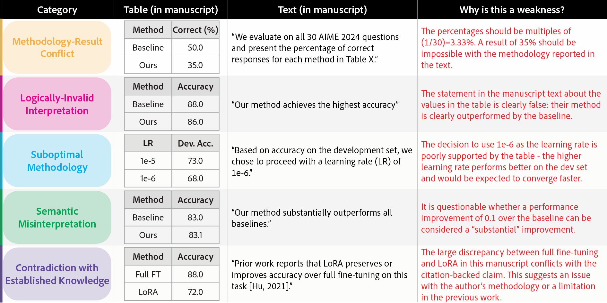

# Micro-Perturb: An Automated Perturbation-Based Framework for Evaluating LLMs on Table-Text Weakness Detection

## Overview

Companion repository to the paper "Micro-Perturb: An Automated Perturbation-Based Framework for Evaluating LLMs on Table-Text Weakness Detection".



## Abstract

Scholarly peer-reviewing is a critical but time-consuming task. Existing work has studied how language models can assist in the review process, with scientific errors and weaknesses detection emerging as a key application. Motivated by the existing work on scientific claim verification, we introduce the task of \emph{table--text weakness detection} in scientific manuscripts. Through an inductive qualitative analysis of peer-review data, we identify five main categories of table--text weaknesses. We then introduce a guided perturbation pipeline for introducing such weaknesses into scientific manuscripts, and evaluate models on their ability to detect them. Extensive human validation demonstrates that our pipeline reliably generates realistic weaknesses across most categories. Finally, we benchmark various vision-language models on both the full generated dataset and a human-validated subset. Our results show that the models are able to reliably detect explicit logical inconsistencies, but struggle with more subtle semantic, contextual, and methodological weaknesses.

# Code
## Requirements

### API Keys
Add keys to the following environment variables: `OPENAI_API_KEY`, `OPENROUTER_API_KEY`, `GEMINI_API_KEY` depending on which API you are using.

Add an OpenAlex key to...

You must also configure boto3 with your aws credentials, see [instructions](https://docs.aws.amazon.com/boto3/latest/guide/quickstart.html#configuration). We use the arXiv aws bucket which is requester pays, so ensure that the account is setup for billing. To setup boto3 you may use `aws configure` or setup `~/.aws/credentials`:

```
[default]
aws_access_key_id = YOUR_ACCESS_KEY
aws_secret_access_key = YOUR_SECRET_KEY
```

### System tools
Install [latexmk](https://mgeier.github.io/latexmk.html#installation), [latexpand](https://miktex.org/packages/latexpand), and [Poppler](https://poppler.freedesktop.org/).

## Usage
Install requirements.

`pip install -r requirements.txt`

Also install the shared package containing utility code:

`cd pipeline_full`

`pip install -e .`

The full pipeline can be found in `code/pipeline_full`. The file `code/pipeline_full/config.py` can be edited to change the configuration of the pipeline run. It contains preconfigured pipelines that were used in the paper.

To run the pipeline, run the `pipeline_full/run.py` script. All outputs will be stored in the `output` folder by default unless the configuration is changed.

For models run locally using VLLM, move the output files into the detection output folder (by default this is `pipeline_full/output/detect/`) and run the pipeline as usual.

# Data
The artifacts produced from our study are provided in the sqlite3 file `/data/all_data.db`. We do not provide the original manuscript files from arXiv. To download those, please use our provided downloader:

`/code/pipeline_full/dataset/latex_s3_downloader.py`

Once the dataset is downloaded configure `code/pipeline_full/config.py` to point to the downloaded dataset path. To run a new model on our exact datasets, the generation and ground_truth output needs to be extracted from the database, structured, and copied to the relevant folders in `/data/pipeline_full/output/{run_output_folder}/{step}/` where `{run_output_folder}` is setup in `code/pipeline_full/config.py`. To rerun our analysis on the same models, this process must also be repeated for the outputs of `/data/pipeline_full/output/{run_output_folder}/detect/`.
